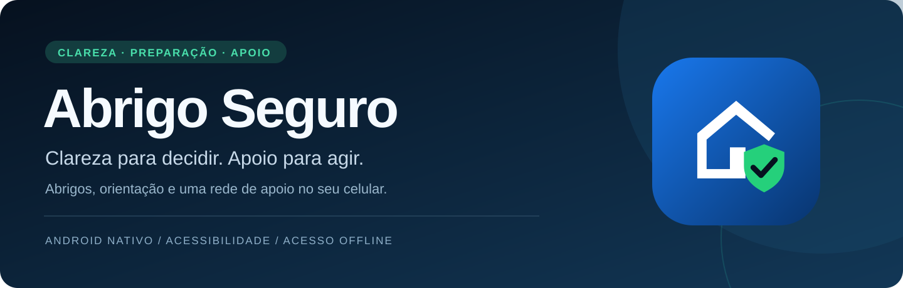
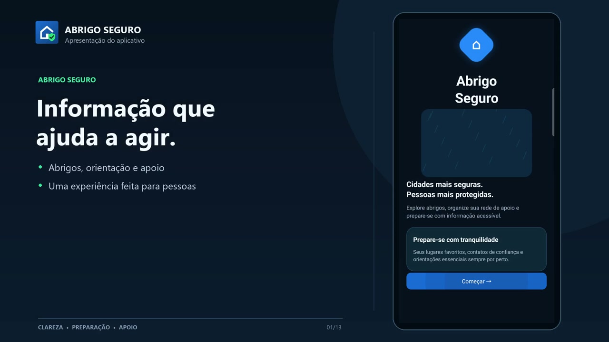
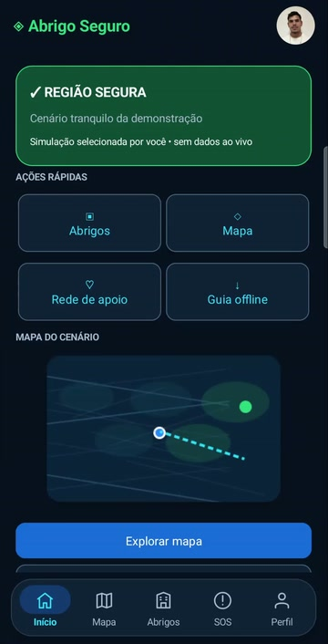
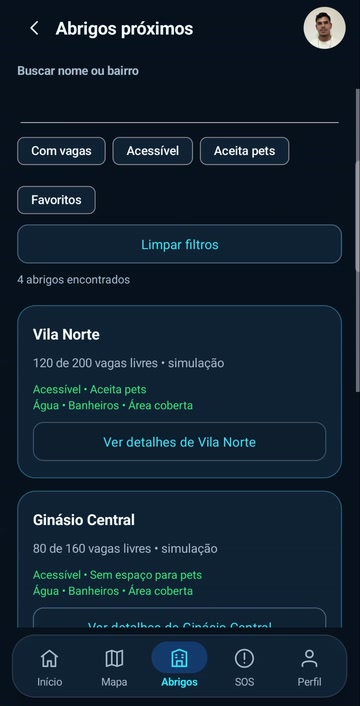
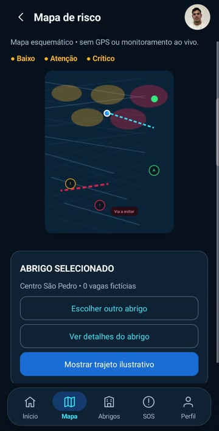
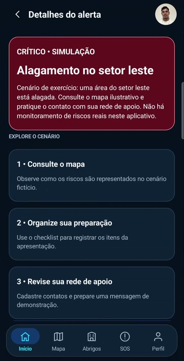
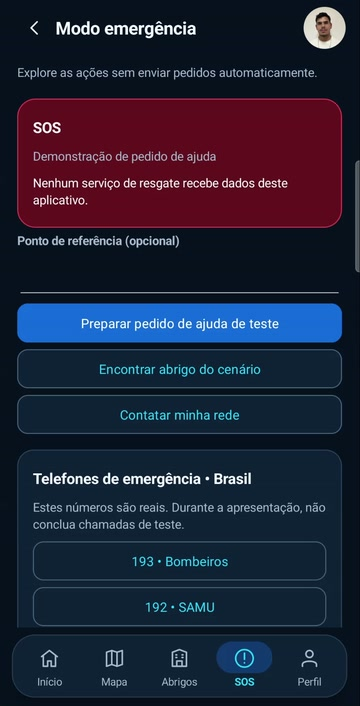
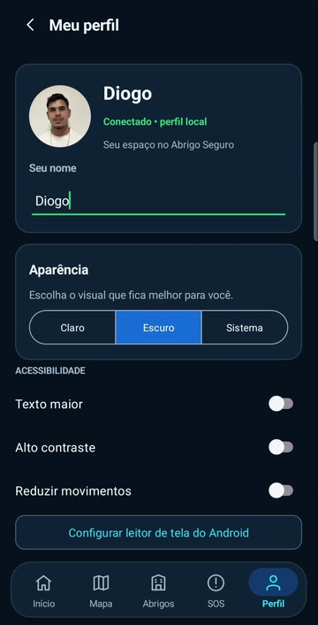

  

# Abrigo Seguro

**Um aplicativo Android que reúne consulta de abrigos, orientação, preparação e contatos de confiança em uma experiência acessível.**

   

**[Baixar APK](https://github.com/WilliamNarimatsu/AbrigoSeguro/releases/download/v1.2.1-demo/AbrigoSeguro-1.2.1-demo.apk) · [Apresentação em vídeo](https://github.com/WilliamNarimatsu/AbrigoSeguro/releases/download/v1.2.1-demo/AbrigoSeguro-apresentacao-FullHD.mp4) · [Guia do professor](docs/GUIA_PROFESSOR.md) · [Executar o projeto](docs/EXECUCAO.md)**

## Conheça em 4 minutos

Onde encontrar um abrigo? Como organizar os itens essenciais? Quem avisar? O Abrigo Seguro conecta essas necessidades em um só aplicativo: da consulta à preparação, do alerta à rede de apoio.

A apresentação de **4min27** mostra o app rodando em um celular, com narração em português brasileiro, legendas e os principais fluxos organizados por assunto.

[Apresentação Full HD — MP4](https://github.com/WilliamNarimatsu/AbrigoSeguro/releases/download/v1.2.1-demo/AbrigoSeguro-apresentacao-FullHD.mp4) · [Versão vertical — MP4](https://github.com/WilliamNarimatsu/AbrigoSeguro/releases/download/v1.2.1-demo/AbrigoSeguro-apresentacao-vertical.mp4) · [Roteiro narrado](docs/ROTEIRO_VIDEO.txt)

> **Para avaliar:** assista à apresentação, instale o APK e siga o [guia do professor](docs/GUIA_PROFESSOR.md). Não é necessário configurar conta, servidor ou chave de API.

## A experiência na prática

<table>
  <tr><th>Início e ações rápidas</th><th>Catálogo de abrigos</th><th>Mapa e destino</th></tr>
  <tr>
    <td></td>
    <td></td>
    <td></td>
  </tr>
  <tr><th>Alertas e orientações</th><th>Fluxo SOS</th><th>Aparência e acessibilidade</th></tr>
  <tr>
    <td></td>
    <td></td>
    <td></td>
  </tr>
</table>

*Capturas extraídas da gravação do aplicativo em um aparelho real. O enquadramento remove apenas as bordas e barras do sistema.*

## O que o aplicativo oferece

| Recurso | O que é possível fazer |
| --- | --- |
| **Abrigos** | Buscar por nome ou bairro, combinar filtros de vagas, acessibilidade e pets, salvar favoritos e consultar capacidade, ocupação e serviços. |
| **Mapa** | Escolher um abrigo e visualizar um trajeto ilustrativo ligado ao destino selecionado. |
| **Alertas** | Filtrar por gravidade, acompanhar avisos não lidos e acessar orientações, mapa, checklist e contatos. |
| **Preparação** | Marcar itens do checklist, acompanhar o progresso e manter as marcações no aparelho. |
| **Rede de apoio** | Cadastrar, editar e excluir contatos, preservar rascunhos e preparar mensagens ou abrir o discador. |
| **SOS** | Informar uma referência, revisar uma mensagem de teste e escolher como compartilhar. Os atalhos de telefone exigem confirmação. |
| **Offline** | Consultar o catálogo embarcado e salvar um pacote local de abrigos e alertas, sem apagar contatos ao removê-lo. |
| **Perfil e acessibilidade** | Usar temas claro, escuro ou do sistema, texto maior, alto contraste e redução de movimentos. |

A navegação inferior mantém **Início, Mapa, Abrigos, SOS e Perfil** sempre acessíveis. As transições de 180 ms respeitam a preferência de redução de movimentos.

## Experimente no Android

1. [Baixe o APK da versão 1.2.1](https://github.com/WilliamNarimatsu/AbrigoSeguro/releases/download/v1.2.1-demo/AbrigoSeguro-1.2.1-demo.apk) no celular.
2. Abra o arquivo e, se o Android solicitar, permita a instalação por esse aplicativo de arquivos ou navegador.
3. Instale, abra **AbrigoSeguro** e conclua a apresentação inicial.

**Compatibilidade:** Android 7.0/API 24 ou superior. O arquivo é um APK de demonstração assinado com chave de desenvolvimento; não é uma publicação na Play Store.

Para abrir no Android Studio, gerar seu próprio APK ou resolver problemas de sincronização, consulte o [guia de execução](docs/EXECUCAO.md). O [código atual em ZIP](https://github.com/WilliamNarimatsu/AbrigoSeguro/archive/refs/heads/main.zip) inclui a documentação mais recente; a [release 1.2.1](https://github.com/WilliamNarimatsu/AbrigoSeguro/releases/tag/v1.2.1-demo) preserva o pacote da entrega do aplicativo.

## Como foi construído

| Camada | Implementação |
| --- | --- |
| Aplicativo | Java, Activities nativas e componentes AndroidX/Material |
| Interface | Componentes compartilhados em `BaseActivity`, barra inferior em `BottomBar` e trajetos em `RouteView` |
| Dados locais | `SharedPreferences` privadas e pacote JSON com gravação atômica |
| Catálogo demonstrativo | Modelos e regras em `DemoData`; estado e persistência em `AppStore` |
| Qualidade | JUnit, Robolectric, Android Lint e pipeline no GitHub Actions |
| Design | [Figma da equipe](https://www.figma.com/design/VpW7EXmIC112EfTkkCEaES/Abrigo-Seguro?node-id=2-2), adaptado para Android nativo |

Veja a [arquitetura e os fluxos de dados](docs/ARQUITETURA.md).

## Qualidade e validação

- **36 testes automatizados aprovados** na entrega 1.2.1, incluindo regras, armazenamento, navegação, temas, ícones e fluxos de tela.
- **Android Lint sem erros**, com 76 avisos documentados na verificação dessa versão.
- **Compilação, testes e lint aprovados no GitHub Actions**: [execução da entrega](https://github.com/WilliamNarimatsu/AbrigoSeguro/actions/runs/41937288477).
- **Execução no celular confirmada pela equipe**, com gravação incluída nos materiais de apresentação.

O [registro de verificação](docs/VERIFICACAO.md) separa o que foi testado automaticamente, a confirmação no aparelho e o que ainda merece uma avaliação manual específica, como TalkBack.

## Documentação

| Quero… | Onde encontrar |
| --- | --- |
| Avaliar o projeto e entender os diferenciais | [Guia do professor](docs/GUIA_PROFESSOR.md) |
| Instalar, abrir no Android Studio ou exportar APK | [Execução e solução de problemas](docs/EXECUCAO.md) |
| Entender a organização do código | [Arquitetura](docs/ARQUITETURA.md) |
| Demonstrar os fluxos ao vivo | [Roteiro de apresentação](docs/APRESENTACAO.md) |
| Conferir os testes e os limites da validação | [Verificação](docs/VERIFICACAO.md) |
| Consultar as entregas e mudanças | [Resumo da entrega](docs/ENTREGA.md) · [Histórico de versões](CHANGELOG.md) |
| Colaborar com o projeto | [Como contribuir](CONTRIBUTING.md) |

## Escopo da demonstração

Esta entrega é um **protótipo funcional acadêmico**, com abrigos, vagas, alertas e trajetos demonstrativos. Não há GPS, monitoramento em tempo real, reserva de vagas ou integração com resgate. O mapa não deve orientar deslocamentos reais.

Os dados pessoais ficam no aparelho. Não há envio para servidores, acesso à agenda ou coleta de localização. Compartilhamentos e chamadas são concluídos pelo usuário em aplicativos externos; nenhuma mensagem ou ligação é enviada automaticamente. Durante a apresentação, não conclua chamadas de teste para serviços de emergência.

## Equipe e referência visual

Desenvolvido pela **equipe Abrigo Seguro**, a partir do projeto original mantido por [WilliamNarimatsu](https://github.com/WilliamNarimatsu). A identidade e os fluxos partem do [Figma criado pela equipe](https://www.figma.com/design/VpW7EXmIC112EfTkkCEaES/Abrigo-Seguro?node-id=2-2).

---

<strong>Abrigo Seguro</strong> Clareza para decidir. Apoio para agir.

