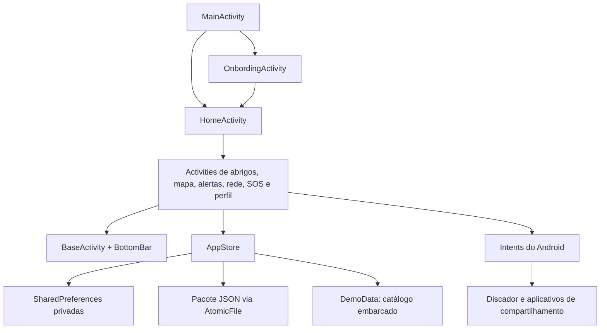

# Arquitetura do aplicativo

[Voltar ao projeto](../README.md) · [Executar](EXECUCAO.md)

## Organização

O aplicativo usa Activities Java e componentes nativos construídos em código. A camada compartilhada centraliza aparência, acessibilidade e navegação; as telas coordenam seus fluxos; os dados ficam no armazenamento privado do Android.



## Responsabilidades

| Componente | Responsabilidade |
| --- | --- |
| `BaseActivity` | Componentes reutilizáveis, paletas, insets, acessibilidade, transições, navegação e preservação de foco/posição. |
| `BottomBar` | Cinco destinos, identificação da aba selecionada, alvos de toque e indicador animado. |
| `AppStore` | Contatos, favoritos, rascunhos, leituras, checklist, temas e pacote offline. |
| `DemoData` | Modelos demonstrativos, catálogo, alertas, busca sem acentos e normalização de telefone. |
| `RouteView` | Desenho do trajeto ilustrativo correspondente ao abrigo selecionado. |
| Activities de cada área | Estado visível, ações e passagem de identificadores entre telas. |

## Estrutura do repositório

```text
AbrigoSeguro/
├── app/
│   ├── src/main/java/com/example/abrigoseguro/  # Aplicativo Java
│   ├── src/main/res/                            # Ícones, temas e ilustrações
│   ├── src/main/AndroidManifest.xml             # Activities e configuração
│   └── src/test/java/com/example/abrigoseguro/   # Testes JUnit/Robolectric
├── docs/
│   ├── assets/                                 # Capa e capturas do README
│   ├── prototipo/layouts/                       # XMLs históricos do protótipo
│   └── *.md                                    # Guias, arquitetura e evidências
├── .github/                                    # CI e modelos de colaboração
├── gradle/                                     # Wrapper e catálogo de versões
├── README.md                                   # Página de apresentação
├── CHANGELOG.md                                # Histórico de entregas
└── CONTRIBUTING.md                             # Orientações de contribuição
```

Os XMLs de `docs/prototipo/layouts/` são referência histórica e não são os layouts executados pelo aplicativo. Os registros em `docs/superpowers/` preservam o planejamento anterior; os guias no índice de documentação descrevem a entrega atual.

## Fluxos de dados

### Abrigos e mapa

A lista aplica os filtros ao catálogo disponível. O detalhe recebe `shelter_id`; a ação de trajeto registra o destino em `map_shelter` e ativa `map_route`. O mapa usa esse destino ao desenhar o percurso. Favoritos ficam nas preferências e atualizam a lista no retorno.

### Contatos e rascunhos

Nome e telefone são validados antes de salvar. A comparação normaliza os números para rejeitar duplicações, inclusive com o prefixo brasileiro. Campos de edição são preservados como rascunho. Salvar ou cancelar encerra a edição e limpa o rascunho.

### Alertas e preparação

A abertura de um alerta registra sua leitura. A central combina gravidade e estado de leitura para filtrar a lista. O checklist guarda cada marcação e recalcula o progresso exibido.

### Conteúdo offline

O pacote contém versão, data de gravação, abrigos e alertas. `AtomicFile` protege a escrita contra interrupções. Se o arquivo estiver ausente ou inválido, o aplicativo volta ao catálogo embarcado. Remover o pacote não remove contatos nem favoritos.

### Aparência e ciclo de vida

O tema é aplicado pelo AppCompat, com paletas para claro/escuro e contraste. A navegação respeita redução de movimentos. Ao retornar de outro aplicativo, a tela evita reconstruções desnecessárias para preservar edição, foco e cursor.

## Fronteiras da implementação

Não há backend, autenticação online, GPS, push ou integração oficial com órgãos públicos. O estado “Conectado • perfil local” identifica o perfil no aparelho. Chamadas e mensagens usam intents; a ação final pertence ao aplicativo externo escolhido pelo usuário.

Essas fronteiras mantêm a demonstração reproduzível e delimitam o que precisaria ser desenvolvido para uma operação real.
